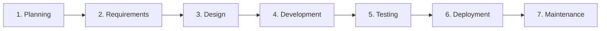

# Contributing to Career Asset Engine CLI (`cae-cli`)

`cae-cli` combines **Spec Kit's Agentic SDLC** with deterministic Rust CI/CD (`rustfmt`, `clippy`, hermetic `cargo test`, and Trivy security scanning). Agents assist with feature assessment, Spec-Driven Development (SDD), implementation, convergence verification, and guided bug triage, while conventional GitHub Actions enforce compilation, linting, testing, and release tagging.

All architectural decisions and contributions are governed by the [Career Asset Engine CLI Constitution](.specify/memory/constitution.md).

---

## 1. The 7-Stage Agentic SDLC



| Stage | ★ Agentic Work (Spec Kit + Coding Agents) | 👤 Human Work & Deterministic Automation |
| :--- | :--- | :--- |
| **1. Planning** | Run the **`assess` workflow** (`/speckit-assess-intake` → `research` → `define` → `shape` → `decide`) stored in `.specify/assessments/<slug>/` to produce a `go`, `needs-clarification`, or `kill` verdict. | Frame feature requests via [`.github/ISSUE_TEMPLATE/feature_request.yml`](.github/ISSUE_TEMPLATE/feature_request.yml); maintainers decide whether to advance. |
| **2. Requirements** | For new CLI subcommands, manifest ecosystems, or ledger schema updates, run `/speckit-specify` against [`.specify/memory/constitution.md`](.specify/memory/constitution.md). | Bounded parser tweaks or CLI help refinements can record requirements directly in the GitHub issue. |
| **3. Design** | Run `/speckit-plan` and `/speckit-tasks` to specify Rust data models (`src/models.rs`), `--json` output contracts, and backward compatibility with `~/.cae/projects/<id>.json`. | Review CLI ergonomics, cross-compatibility with `AICareerAssetEngine` (`SPEC-031`), and traversal bounds. |
| **4. Development** | Execute `/speckit-implement` or pair-program with Antigravity (`agy`) using `@rust-pro` and Constitution Principles I–V. | Review changes with `.opencodereview/rule.json`, verify zero `.unwrap()` on fallible I/O, and disclose AI provenance. |
| **5. Testing** | Run `/speckit-converge` to verify all specification tasks are complete; run `/speckit-bug-test` for bug verification. | Deterministic CI ([`.github/workflows/test.yml`](.github/workflows/test.yml)) runs `cargo fmt --check`, `cargo clippy -- -D warnings`, `cargo test`, and Trivy (`vuln,secret,misconfig`). |
| **6. Deployment** | *No agentic execution.* Version bumping and release tagging are deterministic. | Trigger [`.github/workflows/release-trigger.yml`](.github/workflows/release-trigger.yml) to bump `Cargo.toml`, tag, and open a release PR. |
| **7. Maintenance** | Run the **`bugfix` workflow** (`/speckit-bug-assess` → human review gate → `/speckit-bug-fix` → `/speckit-bug-test`) stored under `.specify/bugs/<slug>/`. | File bug reports via [`.github/ISSUE_TEMPLATE/bug_report.yml`](.github/ISSUE_TEMPLATE/bug_report.yml); review weekly [Dependabot](.github/dependabot.yml) PRs (`cargo` & `github-actions`). |

---

## 2. Choosing the Right Path (Scale-Appropriate SDD)

- **Bounded Fixes** (edge-case manifest parsing fix, error message improvement, dependency bump): Use a standard Issue + PR or the guided `bugfix` workflow (`/speckit-bug-assess` → `/speckit-bug-fix` → `/speckit-bug-test`).
- **Substantial Features** (new CLI subcommand, new ecosystem manifest parser, changes to `~/.cae/projects/<id>.json` ledger schema):
  1. **Assess**: `specify workflow run assess` or `/speckit-assess-intake` → `/speckit-assess-decide`.
  2. **Specify & Plan**: `specify workflow run speckit` or `/speckit-specify` → `/speckit-plan` → `/speckit-tasks`.
  3. **Implement & Converge**: `/speckit-implement` → `/speckit-converge`.

---

## 3. Internal Team Trust Model & Constitutional Gates

1. **Human Review Gates**: Agentic assessments (`assess` and `bug-assess`) provide structured evidence and pause at human gates before specification or remediation proceeds.
2. **Constitutional Non-Negotiables**:
   - **Local-First Ledger Integrity (Principle I)**: Strictly offline operation; backward-compatible JSON ledger schema under `~/.cae/projects/<id>.json`.
   - **Read-Only Git Introspection (Principle III)**: `src/git.rs` must never mutate a tracked repository's working tree, staging index, or commit history.
   - **Hermetic Tempdir Testing (Principle IV)**: All tests must use isolated temporary directories and never touch the developer's live `~/.cae/` ledger.
   - **Dual Output & Zero Warnings (Principle V)**: Support both human terminal output and `--json`, and pass `clippy -D warnings`.

---

## 4. AI Assistance & Provenance Disclosure

When contributing changes authored or assisted by Antigravity (`agy`) or Spec Kit workflows, include an **AI Assistance Disclosure** in your PR description:

- **Tool & Integration**: e.g., `Google Antigravity (agy) + Spec Kit v1.2.4`
- **Model & Mode**: e.g., `Gemini / Claude`
- **Skills / Workflows Used**: e.g., `/speckit-specify`, `/speckit-plan`, `@rust-pro`
- **Extent**: e.g., `Scaffolded parser logic and hermetic tempdir tests; human reviewed error handling and schema compatibility`

---

## 5. Local Verification Checklist

Before opening or merging a Pull Request, run:

```bash
# 1. Verify Spec Kit extensions and workflows
specify extension list
specify workflow list

# 2. Check Rust Formatting & Clippy Lints
cargo fmt --all -- --check
cargo clippy --all-targets --all-features -- -D warnings

# 3. Run Hermetic Unit & Integration Tests
cargo test --all-targets --all-features
```
